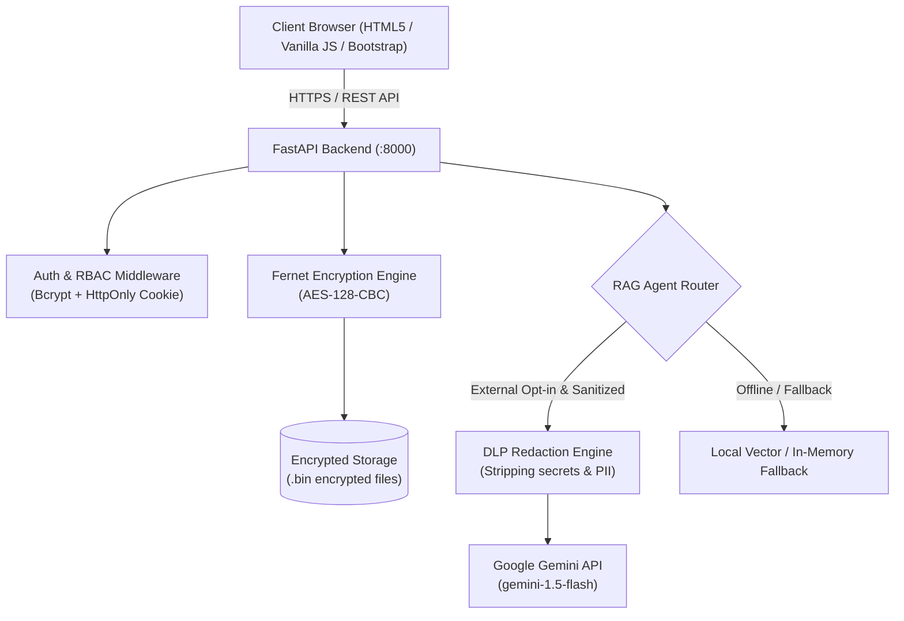

# 🛡️ Nexus AI — Secure Enterprise Document Search & AI Assistant

[](https://www.python.org/)
[](https://fastapi.tiangolo.com/)
[](https://getbootstrap.com/)
[](https://cryptography.io/)
[](https://ai.google.dev/)
[](#acknowledgements)

**Nexus AI** (NexusDocs) is an enterprise-grade, privacy-first internal document search portal and AI assistant. It empowers authenticated employees to upload confidential documents (PDFs and text files), run semantic vector search, analyze files for security leaks, and converse with an AI agent—while ensuring complete document encryption at rest and strict role-based access control (RBAC).

---

## 🌟 Key Features

- **🔐 Cryptographic Encryption at Rest**  
  Every uploaded document is automatically encrypted using **Fernet (AES-128-CBC + HMAC-SHA256)** before writing to disk. Zero plaintext files touch persistent storage.
- **🛡️ Strict Role-Based Access Control (RBAC)**  
  Three distinct user roles:
  - **Administrator:** Full workspace visibility, user management, and restricted document uploading.
  - **Standard User:** Isolated private workspace; can only view, search, and chat with their own documents.
  - **Auditor:** Read-only compliance access to all documents, activity logs, and encryption audits.
- **🤖 Dual-Engine Hybrid RAG (Retrieval-Augmented Generation)**  
  - **Google Gemini 1.5 Flash:** Cloud LLM generation for in-depth reasoning and summarization.
  - **Local Neural/Vector Fallback:** 100% offline-capable deterministic RAG agent when external AI is disabled or offline.
- **🔍 Sensitive Data Loss Prevention (DLP)**  
  Automatic server-side regex redaction engine sanitizes passwords, private keys, API keys, payment card numbers, SSNs, and phone numbers *before* sending authorized document excerpts to external LLMs.
- **🔒 Hardened Authentication & Session Security**  
  - Secure bcrypt password hashing with unique per-password salts.
  - `HttpOnly`, `SameSite=Strict` session cookies protecting against XSS and CSRF attacks.
  - CORS origin allowlist verification and brute-force rate limiting.
- **🎨 Modern, Responsive Web Interface**  
  - Built with clean Vanilla JavaScript, Bootstrap 5.3, and modern CSS glassmorphism.
  - One-click Dark / Light mode toggle.
  - Live statistics dashboard, document search filters, file viewer, and interactive conversational chat.

---

## 📐 System Architecture



---

## 📁 Repository Structure

```text
Nexus AI/
├── Nexus Ai/
│   ├── assets/                      # Application icons, graphics, and brand media
│   ├── backend/
│   │   ├── app/                     # Backend helper modules
│   │   ├── storage/                 # Local encrypted data & user database (.gitignore)
│   │   ├── .env.example             # Configuration template (safe for git)
│   │   ├── .gitignore               # Backend-specific ignore rules
│   │   ├── main.py                  # FastAPI REST server & business logic
│   │   ├── requirements.txt         # Python dependencies
│   │   └── test_system.py           # Comprehensive integration test suite
│   ├── css/
│   │   ├── chat.css                 # Conversational chat styling
│   │   └── style.css                # Core design system & theme variables
│   ├── js/
│   │   └── script.js                # Frontend client logic & API bindings
│   ├── ai-chat.html                 # Document AI Assistant interface
│   ├── dashboard.html               # Analytics & quick-actions dashboard
│   ├── documents.html               # Document repository & upload center
│   ├── index.html                   # Secure login & registration portal
│   ├── profile.html                 # User profile management
│   └── settings.html                # System settings & admin controls
├── QUICKSTART.md                    # Quick onboarding walkthrough
├── SECURITY_REVIEW.md               # Security assessment & remediation log
├── TECH_STACK_AND_SECURITY.md       # Comprehensive architecture documentation
└── .gitignore                       # Repository-wide Git ignore rules
```

---

## 🚀 Quick Start Guide

### Prerequisites
- **Python 3.10+** (Tested on Python 3.12 & 3.14)
- **Git**
- A modern web browser (Chrome, Edge, Firefox, Brave)

---

### Step 1: Set Up & Start Backend

Open PowerShell or terminal in the repository:

```powershell
# Navigate to the backend directory
cd "Nexus Ai/backend"

# Create a virtual environment
python -m venv .venv

# Activate the virtual environment
# Windows PowerShell:
.\.venv\Scripts\Activate.ps1
# macOS/Linux:
# source .venv/bin/activate

# Install required packages
pip install -r requirements.txt

# Create your local environment file from template
Copy-Item .env.example .env
# (On Linux/macOS: cp .env.example .env)

# Run the FastAPI server
uvicorn main:app --reload --port 8000
```
*Backend will be live at `http://127.0.0.1:8000` with interactive Swagger docs at `http://127.0.0.1:8000/docs`.*

---

### Step 2: Serve the Frontend

In a **separate terminal window**:

```powershell
# Navigate to the frontend directory
cd "Nexus Ai"

# Start a local static HTTP server
python -m http.server 5500
```

Now open your browser at:  
👉 **[http://localhost:5500/index.html](http://localhost:5500/index.html)**

---

## 👥 Demo Accounts

The local development environment includes seeded accounts for instant evaluation:

| Role | Username | Default Password | Access Level |
|---|---|---|---|
| **Administrator** | `admin` | `AdminPass123!` | Complete access, user control, system audit |
| **Standard User** | `user` | `UserPass123!` | Isolated personal documents & AI chat |
| **Auditor** | `auditor` | `AuditorPass123!` | Read-only compliance & security audit logs |

> 🔒 *Note: In production environments, passwords and JWT secrets must be set via `.env` variables and default accounts are automatically disabled.*

---

## 🤖 Optional: Configuring Google Gemini

Nexus AI includes a fully functional offline local RAG agent. If you wish to enable Google Gemini:

1. Obtain a free API key from [Google AI Studio](https://aistudio.google.com/).
2. Open `Nexus Ai/backend/.env`.
3. Set your variables:
   ```env
   GEMINI_API_KEY=your_actual_api_key_here
   ENABLE_EXTERNAL_GEMINI=true
   GEMINI_MODEL=gemini-1.5-flash
   ```
4. Restart the backend. Sensitive tokens will be automatically redacted before transmission.

---

## 🧪 Running Automated Tests

A complete automated end-to-end integration test is provided:

```powershell
cd "Nexus Ai/backend"
python test_system.py
```

This verifies:
- ✅ Backend health & routing
- ✅ Admin and standard user authentication
- ✅ Strict multi-tenant RBAC isolation
- ✅ AI chat generation & vector context retrieval
- ✅ Cryptographic at-rest encryption verification

---

## 📤 Uploading to GitHub

Follow these steps to upload this repository to your GitHub profile:

```powershell
# 1. Initialize git in the repository root
git init

# 2. Stage all clean project files
git add .

# 3. Check status to verify secrets/caches are ignored
git status

# 4. Commit files
git commit -m "feat: initial commit of Nexus AI secure document search portal"

# 5. Rename branch to main
git branch -M main

# 6. Link to your GitHub repository (replace with your repo URL)
git remote add origin https://github.com/<your-username>/Nexus-AI.git

# 7. Push to GitHub
git push -u origin main
```

---

## 🔒 Security & Privacy Notice

- All `.env` files and active credentials are removed from version control via `.gitignore`.
- Encrypted file contents (`*.bin`) and SQLite databases (`*.db`) are ignored to prevent leaking personal/school documents.
- Always keep `GEMINI_API_KEY` private and never commit `.env` to public repositories.

---

## 🎓 Acknowledgements

Developed as part of the **Bano Qabil BootCamp Project** initiative, empowering youth with advanced tech education and real-world software engineering capabilities.
